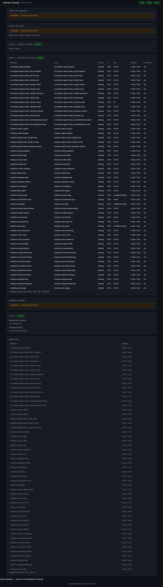

# Aerial

> **Pilot-less, automated agent ops. Agents fly solo — always finding opportunities for you.**

Aerial is the control tower for your agent fleet — the operations layer that supervises, triages, and accounts for agent work on your own hardware.

**Set up in an afternoon. Runs around the clock.**

| | |
|---|---|
| **5 min** | clone to running console |
| **435** | tests green on every release |
| **5/5** | gauntlet layers, or it doesn't ship |
| **15 min** | between fleet reports — tokens, tok/s, saturation |
| **0** | bytes of telemetry |

This is the open-source split of an internal deployment. Everything
runs with **generic defaults** out of the box: `localhost` URLs, no
email recipient (delivery disabled), and runtime state under
`~/.aerial/`. Deployment-specific values (node names, recipients,
host paths, service units) live in a gitignored profile — see
[Deployment profile](#deployment-profile).

## Layout

| Path | What it is |
| --- | --- |
| `dashboard/` | Daily board, exec report, operator console, followup/ops-agent loop, gauntlet, VRAM manager |
| `integration/` | Scheduler, shadow-hierarchy runner, qualification harness, hermetic-cycle tests |
| `gateway/` | The second-brain gateway: MCP server + bridge to the ticket hub |
| `deployment_profile.py` | Single source of config defaults (env vars / deployment.yaml override it) |
| `docs/` | Testing service, pipeline checkpoints, decision points, buglist |
| `config/deployment.yaml.example` | The deployment profile template |

## Quick start

See **[GETTING-STARTED.md](GETTING-STARTED.md)** for the full
zero-to-running walkthrough. In short:

1. `cp config/deployment.yaml.example config/deployment.yaml` (optional — generic defaults work)
2. Start the ticket hub (not in this repo — external service on `:8020`)
3. `python3 dashboard/serve_console.py` (console on `:8777`, bearer-authed)
4. `python3 -m dashboard.followup.runner --interval 300` (ops agent)
5. `python3 integration/scheduler.py --interval 30` (shadow scheduler)

Requires Python 3.10+ (no third-party runtime dependencies). Nothing
phones home; the hub, console, and seats are all services you run
yourself. Feature tour — including the head-to-head vs DeepSeek Harness: [FEATURES.md](FEATURES.md).

## Deployment profile

All deployment-specific values come from, in order of precedence:

1. Environment variables — `AERIAL_<SECTION>__<KEY>` (double underscore
   nests), e.g. `AERIAL_EMAIL__RECIPIENT_EMAIL=ops@example.com`. Flat
   aliases like `AERIAL_NODE_NAME` also work.
2. `config/deployment.yaml` (copy from `deployment.yaml.example`; it is
   gitignored — never commit a real profile).
3. Generic defaults in `deployment_profile.py` (localhost, empty
   recipient, `~/.aerial` state root).

Key settings:

- `email.recipient_email` — empty disables email delivery entirely.
- `cluster.node_name`, `cluster.provider`, `cluster.model` — the node
  prefix used in job ids, service units, and agent dispatch.
- `paths.state_dir` — root for logs, data, hub snapshots, workspaces.
- `paths.repo_paths` — git repos scanned for the daily DONE digest.

## Docs

- [`GETTING-STARTED.md`](GETTING-STARTED.md) — zero to a running stack: config, services, health checks, troubleshooting
- [`FEATURES.md`](FEATURES.md) — the feature list by area, with code locations
- [`docs/testing-service.md`](docs/testing-service.md) — the testing service and how suites map to it
- [`docs/pipeline-checkpoints.md`](docs/pipeline-checkpoints.md) — PC-1..PC-7 conformance checkpoints
- [`docs/decision-points.md`](docs/decision-points.md) — recorded decision points
- [`docs/BUGLIST.md`](docs/BUGLIST.md) — running fix log (resolved and open items)

See also [PRIVACY.md](PRIVACY.md), [SECURITY.md](SECURITY.md),
[TECHNICAL.md](TECHNICAL.md), [CONTRIBUTING.md](CONTRIBUTING.md),
[FAQ.md](FAQ.md).

## License

MIT — see [LICENSE](LICENSE).
