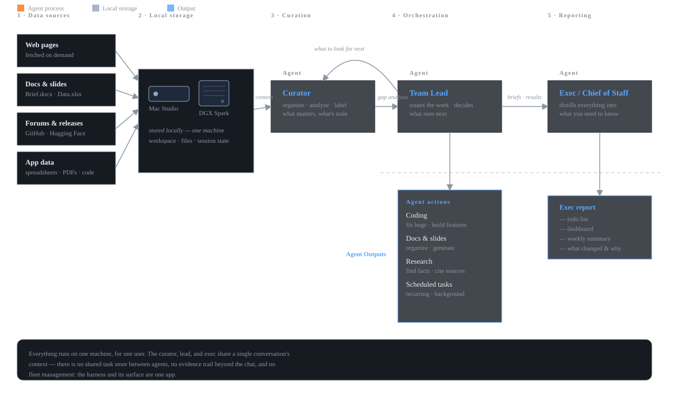

# Aerial

An operations layer for autonomous agent fleets: a ticket hub (system of
record), an ops agent that detects failures and applies governed fixes,
an operator console, and a fleet manager for local model seats. MIT
licensed, self-hosted, no telemetry.

**Status: pilot release (beta).** The core is tested (435 + 671
automated checks) and runs in production daily, but packaging, first-run
onboarding, and model-selection UX are still in progress — see
[ROADMAP.md](ROADMAP.md) and the running fix log in
[docs/BUGLIST.md](docs/BUGLIST.md).



## How it works

- **Ticket hub** (`hub/`) — FastAPI service on `:8020` backed by SQLite.
  Tickets are the shared context unit: multiple agents and roles work
  the same task, each inheriting the chain of evidence, decisions, and
  history. Token scoping is actor×family×action, deny-by-default.
- **Ops agent** (`dashboard/followup/runner.py`) — polls every 5 minutes:
  failed job runs, health anomalies, and seat liveness are classified
  (R1–R6 — security findings ping immediately, unknown classes fail
  closed), routed to governed safe-fix sessions, and re-verified against
  the exact symptom before a finding closes. Registered remediations
  must prove the fix by re-running the symptom probe; unproved fixes
  escalate with before/after output attached.
- **Operator console** (`dashboard/serve_console.py`) — WSGI dashboard
  on `:8777`: daily board, exec report, sparklines, exception queue with
  approve/dismiss/escalate. Read token gates GETs; decision writes
  require a distinct write token (sharing them is rejected).
- **Scheduler** (`integration/scheduler.py`) — cron-shaped runner that
  chains curator → lead → exec sessions over failures and posts the
  brief to the hub. New behavior shadow-runs under a promotion gate
  (divergence, cost, observation window) before going live.
- **Fleet manager** (`dashboard/vram_manager.py`,
  `dashboard/idle_broker/`) — models resident on VRAM by default,
  demand displaces idle, and measured-idle seats pull from a
  pre-approved backlog. Seat liveness is probed every cycle; dead seats
  are findings with registered remediations.

Verification: `python3 bin/aerial_verify.py` — checks hub, console,
state dir, ledger, and model seats; prints a pass/fail table.

## Layout

| Path | What it is |
| --- | --- |
| `hub/` | Ticket hub: FastAPI app, store (per-thread SQLite connections), token scoping, tests |
| `dashboard/` | Console, daily board, exec report, followup/ops-agent loop, remediation contract, gauntlet, VRAM manager, idle-work broker |
| `integration/` | Scheduler, shadow-hierarchy runner, qualification harness, hermetic-cycle tests |
| `gateway/` | Second-brain gateway: MCP server, ingest bridge to the hub |
| `bin/` | `aerial_verify.py`, `pii_scan.py` (publish gate), model-call tooling |
| `deployment_profile.py` | Config resolution: env → deployment.yaml → defaults |
| `config/deployment.yaml.example` | Configuration template |
| `docs/` | Architecture, testing service, pipeline checkpoints, decision points, buglist |

## Install

Python 3.10+, no third-party runtime dependencies for the core services
(`gateway/` ships its own `pyproject.toml` if you use the MCP server).

```bash
git clone https://github.com/rl-ai/aerial.git
cd aerial
cp config/deployment.yaml.example config/deployment.yaml
mkdir -p ~/.aerial/secrets
head -c 32 /dev/urandom | xxd -p -c 64 > ~/.aerial/secrets/hub-token
chmod 600 ~/.aerial/secrets/hub-token

TICKET_HUB_HOME=~/.aerial/hub-home python3 hub/api.py            # hub :8020
PYTHONPATH="$PWD:$PWD/dashboard" python3 dashboard/serve_console.py   # console :8777
PYTHONPATH="$PWD:$PWD/dashboard" python3 -m dashboard.followup.runner --interval 300  # ops agent
```

Verify: `python3 bin/aerial_verify.py`. Full walkthrough including
systemd units and troubleshooting: [GETTING-STARTED.md](GETTING-STARTED.md).

## Configuration

Resolution order: environment variables (`AERIAL_<SECTION>__<KEY>`,
double underscore nests; flat aliases like `AERIAL_NODE_NAME` also work)
→ `config/deployment.yaml` (gitignored — never commit a real profile) →
generic defaults in `deployment_profile.py`.

Key settings:

- `cluster.node_name` — prefix used in job ids, service units, dispatch
- `cluster.hub_url`, `cluster.hub_token_file` — hub endpoint and bearer
- `email.recipient_email` — empty disables email delivery entirely
- `paths.state_dir` — root for logs, data, hub snapshots, workspaces
- `dashboard/vram_registry.json` — model seats: name, port, service
  unit, load command, displacement tier

## Testing

`python3 -m pytest dashboard/tests -q` (435 tests) and
`python3 -m pytest hub/tests -q` (671 tests). The gauntlet
(`dashboard/gauntlet.py`) runs five acceptance layers — unit suites,
adversarial stress, backtest, a simulated day-in-the-life, and live
smoke — and a release requires 5/5.

## Docs

- [`GETTING-STARTED.md`](GETTING-STARTED.md) — zero to running stack: config, services, health checks, troubleshooting
- [`FEATURES.md`](FEATURES.md) — feature list by area with code locations, including the head-to-head vs DeepSeek Harness
- [`docs/FLOW.md`](docs/FLOW.md) — data-flow diagram and stage narrative
- [`docs/design-tokens.md`](docs/design-tokens.md) — design tokens for the architecture diagram
- [`docs/testing-service.md`](docs/testing-service.md) — the testing service and how suites map to it
- [`docs/pipeline-checkpoints.md`](docs/pipeline-checkpoints.md) — PC-1..PC-7 conformance checkpoints
- [`docs/decision-points.md`](docs/decision-points.md) — recorded decision points
- [`docs/BUGLIST.md`](docs/BUGLIST.md) — running fix log (resolved and open items)

See also [PRIVACY.md](PRIVACY.md), [SECURITY.md](SECURITY.md),
[TECHNICAL.md](TECHNICAL.md), [CONTRIBUTING.md](CONTRIBUTING.md),
[FAQ.md](FAQ.md).

## License

MIT — see [LICENSE](LICENSE).
