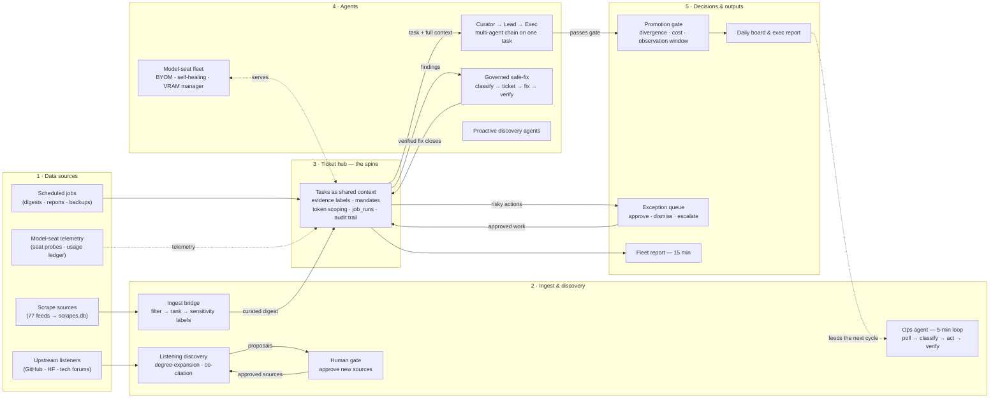

# How data flows

From raw sources to governed action. The ticket hub is the spine: every
claim, decision, and fix attaches to a task with evidence.

## The five stages

1. **Data sources** — 77 scrape feeds, upstream listeners (GitHub,
   Hugging Face, tech forums), scheduled jobs, and live model-seat
   telemetry.
2. **Ingest & discovery** — the ingest bridge filters, ranks, and
   sensitivity-labels everything into a curated digest; the listening
   pipeline discovers *new* sources worth following (degree-expansion,
   co-citation) and files proposals through a human gate.
3. **Ticket hub — the spine** — tasks are the shared context unit.
   Multiple agents and roles work the same task, each inheriting the
   full chain of evidence, decisions, and history. Token scoping is
   deny-by-default; every action lands on the audit trail.
4. **Agents** — the swarm: the curator → lead → exec chain runs multi-agent
   workflows on a single task; governed safe-fixes close the loop from
   failure to verified fix; the model-seat fleet runs BYOM with
   self-healing seats and VRAM management.
5. **Decisions & outputs** — risky actions wait in the exception queue
   for a human; releases pass the promotion gate and a 5/5 gauntlet;
   the daily board, exec report, and 15-minute fleet report close the
   loop — and feed the next cycle.

## Always-on infrastructure

Self-maintenance runs underneath all of it: the ops agent polls every
5 minutes, failures are classified (R1–R6 — security pings
immediately), governed safe-fixes run without a human in the loop,
self-healing seats detect → eject → relaunch → verify, and scheduled
listeners watch GitHub, Hugging Face, and tech forums so the system
updates and improves itself. Everything is local: hub, console,
runners, and models on your hardware — zero telemetry.
